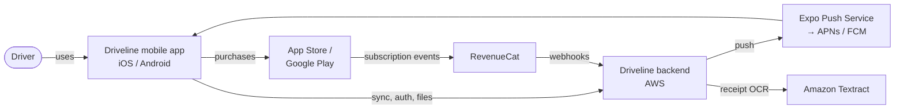
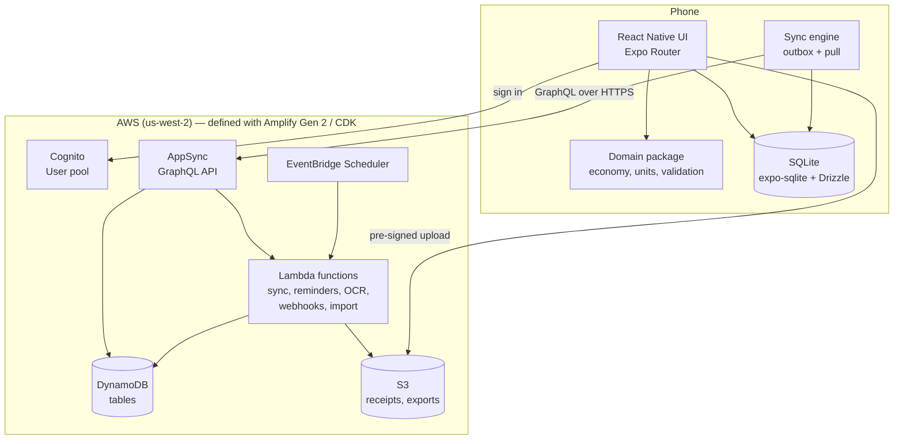
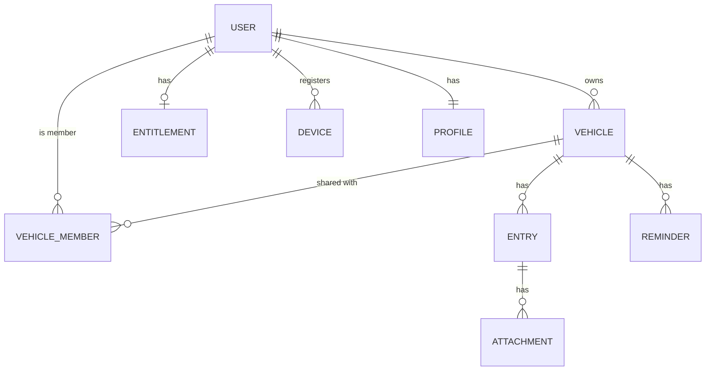
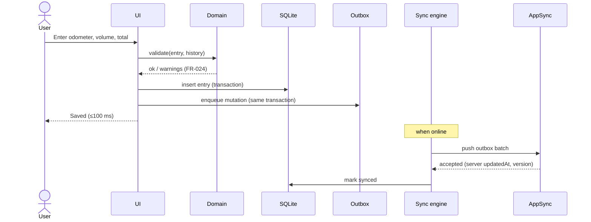

# Driveline — Software Architecture Document

| | |
|---|---|
| **Status** | Draft v0.1 |
| **Owner** | Engineering |
| **Last updated** | 2026-11-19 |
| **Related** | [PRD](01-product-requirements.md) · [ADRs](adr/README.md) · [Security & Privacy](04-security-privacy.md) |

This document describes **how** Driveline is built. It follows a lightweight [C4](https://c4model.com/) structure (context → containers → components). The reasoning behind each major choice lives in an [Architecture Decision Record](adr/README.md); this document links to them rather than repeating them.

Diagrams use Mermaid, which GitHub renders natively.

---

## 1. Architectural goals

In priority order:

1. **Correct data, always.** Logging and economy math must never silently lose or corrupt data (NFR-004).
2. **Offline-first.** Every core action works without a network (NFR-003).
3. **Low running cost.** Serverless, pay-per-use services only; no always-on servers (NFR-011).
4. **Simple to operate for one developer.** Managed services, infrastructure as code, automated deploys.
5. **Replaceable vendors.** Third-party services sit behind interfaces so they can be swapped.

## 2. System context



## 3. Containers



| Container | Technology | Responsibility | ADR |
|---|---|---|---|
| Mobile app | Expo SDK 58, React Native, TypeScript, Expo Router | All UI, local storage, offline logic | [0002](adr/0002-mobile-expo-react-native.md) |
| Domain package | Plain TypeScript, no I/O | Economy math, unit conversion, validation, importers' parsing | [0003](adr/0003-monorepo-and-shared-domain.md) |
| Local database | SQLite via `expo-sqlite`, Drizzle ORM | Source of truth on device | [0004](adr/0004-offline-first-sync.md) |
| Sync engine | TypeScript in the app | Push local changes, pull remote changes | [0004](adr/0004-offline-first-sync.md) |
| Auth | Amazon Cognito (email, Apple, Google) | Identity, tokens | [0005](adr/0005-backend-amplify-gen2.md) |
| API | AWS AppSync (GraphQL) | Authorised data access, custom sync queries | [0005](adr/0005-backend-amplify-gen2.md) |
| Database | Amazon DynamoDB (on-demand) | Cloud copy of user data | [0005](adr/0005-backend-amplify-gen2.md) |
| File storage | Amazon S3 | Receipts, vehicle photos, export bundles | [0005](adr/0005-backend-amplify-gen2.md) |
| Functions | AWS Lambda (Node.js, TypeScript) | Sync helpers, reminders, OCR, webhooks | [0005](adr/0005-backend-amplify-gen2.md) |
| Notifications | `expo-notifications` (local) + Expo Push Service (remote) | Reminder alerts | [0006](adr/0006-push-notifications.md) |
| Subscriptions | App Store / Google Play via RevenueCat | Pro entitlement | [0007](adr/0007-subscriptions-revenuecat.md) |
| Receipt OCR | Amazon Textract `AnalyzeExpense` | Extract receipt fields (Pro) | [0008](adr/0008-receipt-scanning-textract.md) |
| Maps & places (v3) | Amazon Location Service | Nearby stations | To be written in v3 |

## 4. Repository structure

A single monorepo using **pnpm workspaces** ([ADR-0003](adr/0003-monorepo-and-shared-domain.md)):

```
driveline/
├── apps/
│   └── mobile/                # Expo app
│       ├── app/               # Expo Router screens (file-based routes)
│       ├── src/
│       │   ├── features/      # One folder per feature: vehicles, entries, reminders, reports…
│       │   ├── db/            # Drizzle schema, migrations, repositories
│       │   ├── sync/          # Outbox, pull, conflict handling
│       │   ├── services/      # Interfaces to vendors (push, purchases, ocr)
│       │   └── ui/            # Design system components
│       └── e2e/               # Maestro end-to-end flows
├── packages/
│   ├── domain/                # Pure business logic + golden tests
│   ├── importers/             # Fuelio / Drivvo CSV parsers
│   └── config/                # Shared ESLint, TypeScript, Prettier configs
├── amplify/                   # Amplify Gen 2 backend (auth, data, storage, functions)
├── docs/                      # This documentation
└── .github/                   # CI workflows, templates
```

## 5. Data model

### 5.1 Entities



| Entity | Key fields | Notes |
|---|---|---|
| **Profile** | `userId`, units, currency, timeZone, locale | One per user |
| **Vehicle** | `id`, `ownerId`, name, make, model, year, energyConfig, tanks[], odometerUnit, archivedAt | `tanks[]` describes each fuel/battery |
| **VehicleMember** | `vehicleId`, `userId`, role (`editor` / `viewer`) | v1.5 sharing |
| **Entry** | `id`, `vehicleId`, `kind` (fillup / charge / expense / service / income), occurredAt, timeZone, odometer, totalCost, currency, note, kind-specific fields | One table, discriminated by `kind` |
| **Reminder** | `id`, `vehicleId`, title, serviceType, dueDate, dueOdometer, repeatMonths, repeatDistance, lastDoneEntryId | |
| **Attachment** | `id`, `entryId`, s3Key, mimeType, ocrStatus | Files in S3 |
| **Entitlement** | `userId`, `pro` (bool), expiresAt, source | Written only by the RevenueCat webhook |
| **Device** | `id`, `userId`, expoPushToken, platform, lastSeenAt | Push targets |

**Common sync fields on every synced record:** `id` (UUIDv7, client-generated), `createdAt`, `updatedAt` (server-assigned), `version` (integer), `deletedAt` (tombstone), `lastModifiedBy`.

### 5.2 Entry kind-specific fields

| Kind | Fields |
|---|---|
| `fillup` | tankId, fuelType, volumeL, unitPrice, isFull, missedPrevious, stationName, stationLocation (optional) |
| `charge` | kWh, locationType (home / public / work), startPct, endPct |
| `expense` | category |
| `service` | serviceTypes[], partsCost, labourCost, shop |
| `income` | source |

### 5.3 DynamoDB access patterns

| Pattern | Key / index |
|---|---|
| Get a vehicle's entries in odometer order | GSI `byVehicle`: PK `vehicleId`, SK `odometer#occurredAt` |
| Pull changes since cursor for a user | GSI `bySyncScope`: PK `syncScope` (owner or shared vehicle), SK `updatedAt` |
| Reminders due today | GSI `byDueDate` on Reminder: PK `dueBucket` (YYYY-MM-DD), SK `vehicleId` |
| A user's devices | PK `userId` |

The exact table layout is generated by Amplify Gen 2 from the `amplify/data/resource.ts` schema. Spike **S-01** ([Roadmap](05-roadmap.md)) validates that the sync queries meet NFR-004 before the design is frozen.

## 6. Key runtime flows

### 6.1 Logging a fill-up (offline-capable)



### 6.2 Sync and conflicts

- **Push:** the outbox sends mutations in order with the record's `version`. The server accepts if `version` matches, otherwise returns the current server record.
- **Pull:** the app asks for changes since its last cursor per sync scope, applies them, and stores the new cursor.
- **Conflicts:** last-writer-wins **per record**, with the server's copy kept as a local "conflict snapshot" for 30 days so nothing is silently lost. Entries are small and usually written by one person, so field-level merging is not worth the complexity. Details and alternatives: [ADR-0004](adr/0004-offline-first-sync.md).
- **Deletes** are tombstones (`deletedAt`), purged after 90 days.

### 6.3 Reminders

- **Date-based** reminders are scheduled as **local notifications** on each device, so they work offline.
- **Distance-based and predicted** reminders (FR-043), and reminders on shared vehicles, are evaluated by a daily Lambda (EventBridge Scheduler) that sends push notifications through the Expo Push Service.
- The app deduplicates so a user never gets the same reminder twice.

### 6.4 Receipt scanning (Pro, v1.5)

1. App requests a pre-signed S3 upload URL (Pro entitlement checked server-side).
2. App uploads the compressed image (≤ 1.5 MB).
3. App calls `scanReceipt(attachmentId)`; Lambda calls Textract `AnalyzeExpense` and maps fields.
4. Result returns to the form for **user review** before saving (FR-071).

## 7. Cross-cutting concerns

| Concern | Approach |
|---|---|
| **Authentication** | Cognito user pool; tokens stored in secure storage (Keychain / Keystore). Guest mode needs no token. |
| **Authorisation** | Enforced in AppSync rules on every model: owner, or member of the vehicle with the right role. Pro features checked against `Entitlement` on the server. Never rely on UI checks. |
| **Validation** | Shared `domain` validators run on device **and** in Lambda resolvers. Zod schemas at API boundaries. |
| **Error handling** | Typed `Result` objects in domain code; user-facing errors are friendly and actionable; unexpected errors reported to crash reporting. |
| **Observability** | CloudWatch logs (structured JSON) and alarms on Lambda errors, AppSync 5xx, DynamoDB throttles; crash and performance reporting in the app (Sentry); no personal data in logs. |
| **Configuration** | Per-environment config from Amplify outputs; secrets in AWS Secrets Manager / Amplify secrets, never in the repo. |
| **Feature flags** | Remote config record per environment to switch features (e.g. crowdsourced prices) without a release. |
| **Internationalisation** | `i18next` string catalogues; `Intl` for numbers, currency and dates. |
| **Accessibility** | Design-system components ship with labels, roles and dynamic-type support; checked in review. |

## 8. Environments

| Environment | Purpose | AWS | App build |
|---|---|---|---|
| **Sandbox** | Each developer's personal backend | Amplify sandbox in the dev account | Expo dev client |
| **Dev** | Integration of `main` | Dev account, branch `main` | EAS internal build |
| **Staging** | Release candidates, beta testers | Dev account, branch `release/*` | TestFlight / Play internal testing |
| **Production** | Real users | **Separate production AWS account** | App Store / Google Play |

Use AWS Organizations to keep production in its own account, isolated from development. See [Security & Privacy §5](04-security-privacy.md#5-aws-account-security).

## 9. Cost model (estimate)

At 10,000 monthly active users, ~20 entries per user per month, all services on-demand:

| Service | Driver | Rough monthly cost |
|---|---|---|
| DynamoDB | ~200k writes, ~2M reads, < 5 GB | < $5 |
| AppSync | ~5M requests | ~$20 |
| Lambda | Sync helpers, daily reminders | < $5 |
| S3 | Receipts (Pro users only) | < $5 |
| Cognito | 10k MAU | Check current Cognito tier pricing |
| Textract AnalyzeExpense | Pro scans only | Pay per page; covered by Pro revenue |

Target is ≤ $0.03 per MAU (NFR-011). Actual figures will be tracked with AWS Budgets and Cost Explorer tags (`app=driveline`, `env=*`), and these estimates refreshed against current AWS pricing before launch.

## 10. Known risks and technical debt register

| ID | Item | Plan |
|---|---|---|
| R-01 | Custom sync engine is the most complex part of the system | Spike S-01, property-based tests, chaos tests (random offline/online) |
| R-02 | Bi-fuel economy is approximate by nature | Documented in [spec §5](specs/fuel-economy.md#5-multi-energy-vehicles) and in-app help |
| R-03 | Vendor change risk (e.g. Amazon Pinpoint end of support 2026-10-30) | Vendors behind `services/` interfaces |

## 11. Change log

| Version | Date | Change |
|---|---|---|
| 0.1 | 2026-11-19 | Initial draft |
