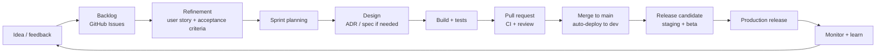

# Driveline — Engineering Standards

| | |
|---|---|
| **Status** | Draft v0.1 |
| **Owner** | Engineering |
| **Last updated** | 2026-11-19 |

These standards describe how Driveline is built, from idea to production. They apply equally to human and AI-written code. If a standard gets in the way, change it through a pull request rather than ignoring it.

---

## 1. Development lifecycle (Agile)

Driveline uses a lightweight Scrum-style process sized for a solo developer or small team.



| Ceremony | Cadence | Output |
|---|---|---|
| Sprint | 2 weeks | Working, tested increment |
| Planning | Start of sprint (≤ 1 h) | Sprint goal and committed issues |
| Backlog refinement | Weekly (≤ 30 min) | Next ~2 sprints of issues are "Ready" |
| Review / demo | End of sprint | Demo on a real device; PO accepts or rejects stories |
| Retrospective | End of sprint (≤ 30 min) | 1–3 improvement actions, recorded in the sprint issue |

### 1.1 Definition of Ready (an issue can enter a sprint when…)

- [ ] Written as a user story or a clear technical task, linked to a requirement ID (`FR-xxx` / `NFR-xxx`) where applicable
- [ ] Acceptance criteria in Given/When/Then form
- [ ] Estimated (story points: 1, 2, 3, 5, 8; anything larger is split)
- [ ] Dependencies and design questions resolved, or a spike is planned
- [ ] UI work has a sketch or design reference

### 1.2 Definition of Done (an issue is done when…)

- [ ] Acceptance criteria met and demonstrated on iOS **and** Android
- [ ] Code reviewed and merged to `main` via pull request; CI green
- [ ] Unit tests written; coverage thresholds met; E2E flow updated if a user journey changed
- [ ] Accessibility checked (screen reader labels, dynamic type, contrast)
- [ ] Strings externalised for translation
- [ ] Documentation updated: PRD, architecture, spec or ADR if behaviour or design changed; `CHANGELOG.md` entry
- [ ] No new warnings or lint errors; no secrets in code
- [ ] Deployed to the dev environment and smoke-tested

## 2. Source control

### 2.1 Branching: trunk-based development

- `main` is always releasable and protected (no direct pushes; PR + green CI + 1 approval required; linear history).
- Short-lived branches from `main`, merged within ~2 days: `feat/123-add-fillup-form`, `fix/141-odometer-warning`, `docs/…`, `chore/…`, `spike/…`.
- Release branches `release/x.y` are cut for store submissions; only fixes are cherry-picked onto them.
- Unfinished features are merged behind **feature flags**, not left on long branches.

### 2.2 Commits: Conventional Commits

```
<type>(<scope>): <summary in imperative, ≤ 72 chars>

<body: what and why, wrapped at 72>

Refs: #123
```

Types: `feat`, `fix`, `docs`, `test`, `refactor`, `perf`, `build`, `ci`, `chore`, `revert`. Breaking changes add `!` and a `BREAKING CHANGE:` footer. Commit messages are linted in CI (commitlint).

### 2.3 Versioning and releases

- **Semantic Versioning** for the app (`MAJOR.MINOR.PATCH`); store build numbers increment automatically in EAS.
- `CHANGELOG.md` follows [Keep a Changelog](https://keepachangelog.com/).
- Each release is tagged `vX.Y.Z` on the commit that was submitted.

## 3. Code standards

### 3.1 Language and tooling

| Area | Standard |
|---|---|
| Language | TypeScript everywhere, `strict: true`, `noUncheckedIndexedAccess: true` |
| Formatting | Prettier (no debates; runs on save and in pre-commit) |
| Linting | ESLint with `typescript-eslint` strict rules, `eslint-plugin-react-hooks`, import ordering, no default exports outside Expo Router screens |
| Pre-commit | Husky + lint-staged: format, lint, type-check changed files |
| Package manager | pnpm; lockfile committed; exact versions for native modules |
| Node | Current LTS, pinned in `.nvmrc` |

### 3.2 Design principles

- **Pure domain, thin edges.** Business rules live in `packages/domain` with no I/O. UI, database and AWS code call into it.
- **Feature folders.** Code is organised by feature (`features/fillups/…`), not by type.
- **Explicit errors.** Domain functions return `Result<T, E>`; exceptions are for programmer errors only. Never swallow errors.
- **No floating-point money.** Money is integer minor units + currency code (PRD §5).
- **Units at the edge.** Store base units; convert only for display.
- **Validate at boundaries.** Zod schemas for API inputs, imports and anything read from storage.
- **Small units.** Functions do one thing; files over ~300 lines or components over ~150 lines are a prompt to split.
- **Readable over clever.** Names explain intent; comments explain *why*, not *what*.
- **Dependencies are a cost.** New dependencies need a reason in the PR description (maintenance, size, licence check). Native modules need an ADR if widely used.

### 3.3 React Native specifics

- Function components and hooks only; state close to where it's used.
- Server and sync state via the local DB (reactive queries); UI state in component state or a small store (Zustand) only when shared.
- All interactive elements have `accessibilityLabel`/`accessibilityRole`; text respects dynamic type.
- Lists use virtualised components; no inline anonymous functions in hot list rows.
- All user-visible strings via `t('key')`.

### 3.4 Backend specifics

- Infrastructure as code only (Amplify Gen 2 / CDK). No manual console changes in staging or production; any emergency change is back-ported to code within 24 hours.
- Least-privilege IAM per function.
- Structured JSON logs with a request ID; never log personal data, tokens or receipt content.
- Lambdas are idempotent where retried (webhooks, sync pushes).

## 4. Testing strategy

| Level | Tool | Scope | Gate |
|---|---|---|---|
| Unit | Vitest | Domain logic, importers, utilities | ≥ 90% line coverage on `packages/*`; golden tests must pass |
| Property-based | fast-check | Economy math invariants, sync merge rules | Runs in CI |
| Component | React Native Testing Library + Jest | Screens and components behaviour | Key flows covered |
| Integration | Vitest against Amplify sandbox | Auth rules, sync resolvers, webhooks | Runs on PRs touching `amplify/` |
| End-to-end | Maestro | Critical journeys on iOS simulator + Android emulator | Runs nightly and on release branches |
| Manual exploratory | Checklist | Real devices before each release | Release checklist |
| Performance | Flashlight / profiling | Cold start, list scrolling | Before each minor release |

**Critical journeys** covered by E2E: onboarding as guest → add vehicle → log 3 fill-ups → see economy; guest → sign up → data preserved; offline logging then sync; reminder fires; import Fuelio file; subscribe (sandbox) → scan receipt.

**Test pyramid rule:** most tests are fast unit tests; E2E tests cover journeys, not edge cases.

## 5. Code review

- Every change goes through a pull request using the [PR template](../.github/pull_request_template.md).
- PRs are small (aim for < 400 changed lines excluding generated files and tests).
- Reviewers check: correctness against acceptance criteria, tests, security and privacy, accessibility, readability, docs updated.
- AI-generated code is reviewed to the same standard as human code; the author is responsible for understanding every line.
- Solo-developer rule: self-review the diff on GitHub after a break, and walk through the PR checklist honestly. Use an AI reviewer as a second pair of eyes, not a substitute.

## 6. CI/CD

GitHub Actions.

| Workflow | Trigger | Steps |
|---|---|---|
| `ci.yml` | Every PR and push to `main` | Install (cached) → commitlint → format check → lint → type-check → unit + component tests with coverage → dependency audit → secret scan (gitleaks) → build check |
| `backend-integration.yml` | PRs touching `amplify/` | Deploy ephemeral Amplify sandbox → integration tests → tear down |
| `deploy-backend.yml` | Merge to `main` → dev; tag `v*` → staging, then **manual approval** → production | `ampx pipeline-deploy` with OIDC role per account (no long-lived AWS keys) |
| `mobile-build.yml` | Merge to `main` → internal build; tag `v*` → store builds | EAS Build → EAS Submit to TestFlight / Play internal testing |
| `e2e-nightly.yml` | Nightly + release branches | Maestro flows on simulators |
| `codeql.yml` | Weekly + PRs | Static security analysis |

**Rules:** CI must pass before merge; production deploys need manual approval in a GitHub Environment; AWS access from CI uses GitHub OIDC with short-lived credentials only.

## 7. Documentation standards

| What | Where | When updated |
|---|---|---|
| Requirements | `docs/01-product-requirements.md` | When scope or behaviour changes |
| Architecture | `docs/02-architecture.md` | When structure, data model or flows change |
| Decisions | `docs/adr/` | For every significant decision (see ADR-0001) |
| Specs | `docs/specs/` | Before implementing complex logic |
| API | Generated from the Amplify schema; custom operations documented in code with TSDoc | With the code |
| Code | TSDoc on exported functions in `packages/*` | With the code |
| Runbooks | `docs/runbooks/` (created in Sprint 0) | Before a feature reaches production |
| Changes | `CHANGELOG.md` | Every user-visible change |

Docs are Markdown, reviewed in PRs, and diagrams are Mermaid so they stay diffable.

## 8. Operations

- **Monitoring:** CloudWatch alarms (Lambda errors, AppSync 5xx, DynamoDB throttles, budget at 80% and 100%) notify by email; Sentry alerts for crash spikes.
- **Incidents:** severity levels S1 (data loss / outage) to S3 (minor); S1 response within 4 hours. Every S1/S2 gets a blameless post-mortem in `docs/postmortems/`.
- **Backups:** DynamoDB point-in-time recovery enabled in production; S3 versioning on the receipts bucket; restore tested once per quarter.
- **Dependency updates:** Renovate weekly, grouped; Expo SDK upgrades planned per release.

## 9. Change log

| Version | Date | Change |
|---|---|---|
| 0.1 | 2026-11-19 | Initial draft |
